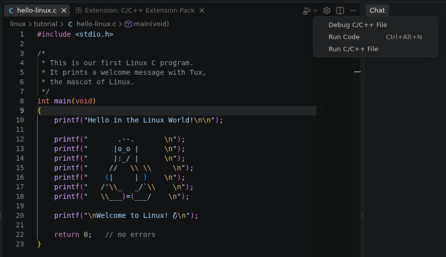

# Hello Linux World: Compiling and Running

A text file is now turned into a running program. The file
[`hello-linux.c`](hello-linux.c) in this directory is a small C program that
prints a greeting and Tux, the Linux mascot.

```
$ cd ~/IP-CS/teiniker-lectures-computerscience/linux/tutorial
$ cat hello-linux.c
```

The source code is readable by humans, but not by the computer. The
**compiler** translates it into machine code, an **executable** file. On Linux
the standard C compiler is **`gcc`** (GNU Compiler Collection).

## Compiling in a Terminal

```
$ gcc -o hello-linux hello-linux.c
```

`gcc` takes the source file as an argument. The option `-o` (**o**utput) gives
the name of the executable to create. Without `-o`, the result would be called
`a.out`.

If everything went well, `gcc` prints nothing at all. A new file has appeared:

```
$ ls -l
-rwxr-xr-x 1 student student 16024 Oct 20 10:15 hello-linux
-rw-r--r-- 1 student student   524 Oct 20 10:14 hello-linux.c
```

`hello-linux.c` is the source code, `hello-linux` is the program. The program is
much larger than its source, because it contains machine code and everything
needed to start it.

## Running in a Terminal

A program in the current directory is started with `./` in front of its name:

```
$ ./hello-linux
Hello in the Linux World!

       .--.
      |o_o |
      |:_/ |
     //   \ \
    (|     | )
   /'\_   _/`\
   \___)=(___/

Welcome to Linux! 
```

## Run the program in VS Code

The same steps work in [Visual Studio Code](VSCode.md).

1. Open the repository with `code .` or via the GUI and open the file
   `hello-linux.c` from the Explorer.
2. **Compile and run** with the play button at the top right. The small arrow
   next to it opens a menu: **Run Code** (`[ctrl] + [alt] + [n]`) compiles and
   runs the file and shows the output in the Output panel. Errors appear
   underlined in the editor and in the **Problems** panel.

   

3. Click left of a line number to set a red **breakpoint**, for example on the
   first `printf`.
4. **Debug** with **Debug C/C++ File** from the same menu, or with `F5`. The
   program starts and stops at the breakpoint. Step through it line by line
   with `F10`, and watch the output appear in the Terminal panel. Continue
   with `F5` or stop with `[shift] + [F5]`.

## Exercise 4

* Change into the tutorial directory and compile `hello-linux.c` into a program
  called `hello-linux`. Run it.
* Change the greeting in the first `printf` to your own text in VS Code,
  compile again and run the program. Is the new text shown?
* Open the file in VS Code, set a breakpoint on the line with `return 0;` and
  start the debugger. In which panel does the output appear?

## References

* [GCC, the GNU Compiler Collection](https://gcc.gnu.org/)
* [A Simple C Program](../../programming-c/c-basics/introduction/hello-world/README.md) (the structure of `main()`, directives and statements)
* [Visual Studio Code: Debug C++ in Visual Studio Code](https://code.visualstudio.com/docs/cpp/cpp-debug)

*Nicoletta Kaehling, 2026, GPL v3.0*
