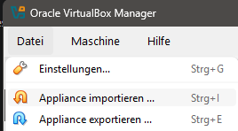
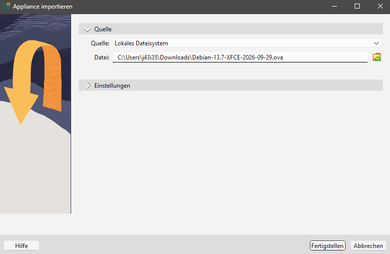
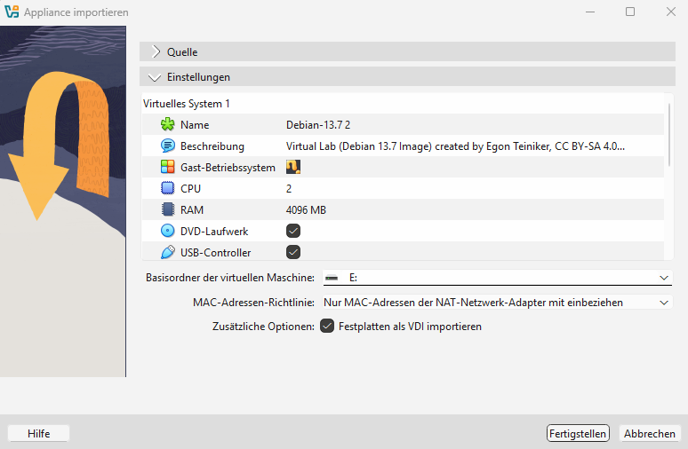

# The Virtual Machine: VirtualBox

In this course we do not install Linux directly on our computers. Instead we
run it as a **virtual machine (VM)** inside **Oracle VirtualBox**: a program
that simulates a complete computer in a window. Linux runs inside that window,
Windows keeps running outside of it. If something goes wrong in the VM, the
host system is not affected, and the VM can simply be reset or re-imported.

## The Virtual Lab Image

The VM is provided as a ready-made image, so no Linux installation is needed:

> **Virtual Lab (Debian 13.7 Image)**, created by Egon Teiniker, CC BY-SA 4.0

The image comes with two accounts:

| User | Password | Purpose |
|---|---|---|
| `student` | `student` | Normal user for everyday work |
| `root` | `root66` | Administrator, only when really needed |

Log in as `student`. Administrative commands can be run from this account with
`sudo`, the `root` password is needed only in exceptional cases.

The image expects a **shared folder** on the host at `c:\shared`. How to set it
up is described below.

## Importing the Image

The VM can live on the computer's hard disk or on a **USB memory stick**. The
import is the same in both cases, only the destination folder differs. The
screenshots show the German user interface, the English menu names are given
in the text.

1. Open **File > Import Appliance...** (`[ctrl] + [i]`).

   

2. Select the downloaded `.ova` file as the source and click **Next**.

   

3. Check the settings. Here the name, the number of CPUs, the RAM and the
   **Machine Base Folder** can be changed. The base folder decides where the
   VM is stored:

   * **Hard disk**: keep the default folder.
   * **Memory stick**: choose a folder on the stick, e.g. `E:\VMs`, as in the
     screenshot. The same VM can then be used at home and in the lab, see
     [Running the VM from a Memory Stick](#running-the-vm-from-a-memory-stick).

   Click **Finish**.

   

Afterwards the VM appears in the list on the left of the VirtualBox window and
can be started with **Start**.

## Running the VM from a Memory Stick

All files of the VM (the `.vbox` configuration file and the virtual disk
`.vdi`) are stored on the stick, so it works on any computer that has
VirtualBox installed. What is needed:

* A stick with at least **32 GB** of free space; the Debian image alone takes
  several GB and grows while working.
* A **USB 3.0** stick and port (blue connector). On USB 2.0 the VM is slow.
* The stick must be formatted with **exFAT**. The usual FAT32
  cannot store files larger than 4 GB, which the virtual disk quickly exceeds.
  Check in the File Explorer with right-click on the drive > **Properties**.

If the stick gets a different drive letter than before (e.g. `F:` instead of
`E:`), VirtualBox may complain that the VM is *inaccessible*. In that case
remove the entry (right-click > **Remove...**, **Remove Only**, never
**Delete all files**) and register the VM again with **Machine > Add...** by
selecting the `.vbox` file on the stick.

* **Shut down** the VM properly and **eject** the stick (**Safely Remove
  Hardware**) before pulling it out. Unplugging a running VM corrupts the
  virtual disk, and all work is lost.
* The shared folder `c:\shared` is configured per host. On another computer it
  has to exist there as well, or the VM starts with a warning and without it.
* Memory sticks are slower than built-in disks. A copy of the `.vdi` file
  before important work is cheap insurance.
* VirtualBox itself cannot normally run from the stick, it has to be installed
  on each host. There is a third-party *Portable-VirtualBox* package, but it
  still needs administrator rights on the host to load its drivers.

## Changing the Memory (RAM)

By default the VM gets a fixed amount of the host's memory. If the VM is too
slow this value can be adjusted. The VM must be **powered off** for this (not
just paused or saved).

1. Select the VM in the VirtualBox window.
2. Click **Settings** (gear icon) or press `[ctrl] + [s]`.
3. Open **System > Motherboard**.
4. Move the **Base Memory** slider or type a value in MB, e.g. `4096` for 4 GB.
5. Confirm with **OK** and start the VM.

## Setting up the Shared Folder

A shared folder is a directory on the host that is also visible inside the
guest. It is the easiest way to move files between Windows and Linux, for
example to hand in exercises or to open a file in a Windows editor.

### Create the folder on Windows

Create the folder `c:\shared` on the host, either in the File Explorer
(**C: > New > Folder**, name it `shared`), or in PowerShell:

```
PS C:\> mkdir C:\shared
```

### Use the folder in Linux

Auto-mounted shared folders appear in the guest under `/media/` with the
prefix `sf_`, so our folder is **`/media/sf_shared`**.

```
$ ls /media/sf_shared
```

Now the folder works in both directions. Create a file in Linux and look for
it in the Windows File Explorer:

```
$ cd /media/sf_shared
$ echo "Hello from Debian VM" > hello.txt
```

Conversely, a file saved to `C:\shared` on Windows shows up immediately in
`/media/sf_shared` in the VM.

## References

* [Oracle VirtualBox User Manual: Shared Folders](https://www.virtualbox.org/manual/ch04.html#sharedfolders)
* [Oracle VirtualBox User Manual: Guest Additions for Linux](https://www.virtualbox.org/manual/ch04.html#additions-linux)
* [Oracle VirtualBox User Manual: System Settings](https://www.virtualbox.org/manual/ch03.html#settings-system)

*Nicoletta Kaehling, 2026, GPL v3.0*
